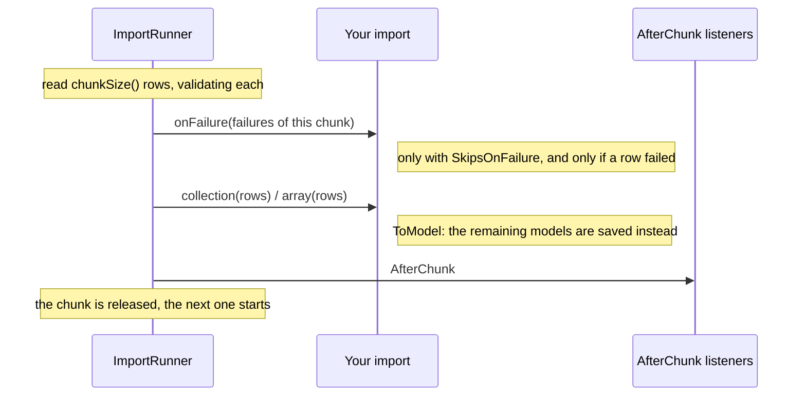

# Imports

An import class is a plain PHP class that implements one or more concern interfaces. The concerns you implement determine how the spreadsheet data is read, validated, and persisted.

## Entry point

```php
use MrDellimore\SheetStream\Facades\SheetStream;

// Synchronous import from a local file path
SheetStream::import(new YourImport, $filePath);

// Queue an import (if ShouldQueue is implemented, import() auto-queues)
SheetStream::queueImport(new YourImport, 'imports/file.xlsx', disk: 's3');
```

For synchronous imports, `$filePath` should be an absolute path to an `.xlsx`, `.csv`, `.tsv`, or `.ods` file. For queued imports with a `disk` parameter, the path is relative to the storage disk.

---

## Import concerns

### ToModel

Map each row to an Eloquent model. Models are saved row-by-row in a streaming fashion — this is the most memory-efficient import strategy.

```php
use App\Models\Claimant;
use Illuminate\Database\Eloquent\Model;
use MrDellimore\SheetStream\Concerns\ToModel;
use MrDellimore\SheetStream\Concerns\WithHeadingRow;

class ClaimantsImport implements ToModel, WithHeadingRow
{
    public function model(array $row): ?Model
    {
        return new Claimant([
            'name'  => $row['name'],
            'email' => $row['email'],
        ]);
    }
}
```

Return `null` from `model()` to skip a row without persisting it.

### ToCollection

Receive all rows as an `Illuminate\Support\Collection` after the entire sheet has been read. Useful when you need to process rows as a batch (e.g. bulk comparisons, deduplication).

```php
use Illuminate\Support\Collection;
use MrDellimore\SheetStream\Concerns\ToCollection;
use MrDellimore\SheetStream\Concerns\WithHeadingRow;

class ClaimantsImport implements ToCollection, WithHeadingRow
{
    public function collection(Collection $rows): void
    {
        foreach ($rows as $row) {
            // $row is a Collection: $row['name'], $row->get('email'), $row->toArray()
        }
    }
}
```

**Each row is an `Illuminate\Support\Collection`**, as in Laravel Excel, keyed by heading with `WithHeadingRow` and by column position without it. `$row['name']`, `isset($row['name'])` and `foreach ($row as $heading => $value)` behave as they do on an array; `is_array($row)` is `false` and the `array_*()` functions need `$row->toArray()` (or `$row->all()`).

Rows were plain arrays up to version 1.2. To keep that, set `collection_rows` to `'array'` in `config/sheet-stream.php`:

```php
'collection_rows' => 'array',
```

The setting applies wherever `collection()` is called: `SheetStream::import()`, queued imports, [`WithChunkReading`](#chunk-reading) and the [`UsesStagingTable`](#usesstagingtable-large-file-pipeline) pipeline. A queued import uses the value in effect when it was queued.

> **Note:** `ToCollection` buffers all rows in memory. For large files, add [`WithChunkReading`](#chunk-reading) to receive the sheet a chunk at a time, or use `ToModel`, which streams row-by-row.

### ToArray

Same as `ToCollection` but receives a plain PHP array of plain arrays, whatever `collection_rows` is set to. With [`WithChunkReading`](#chunk-reading) it is called once per chunk.

```php
use MrDellimore\SheetStream\Concerns\ToArray;

class ClaimantsImport implements ToArray
{
    public function array(array $rows): void
    {
        // $rows is an array of arrays
    }
}
```

---

## Configuration concerns

### WithHeadingRow

Treats the first row of the sheet as column headings. Subsequent rows are delivered as associative arrays with lowercased, trimmed heading keys.

```php
use MrDellimore\SheetStream\Concerns\WithHeadingRow;

class ClaimantsImport implements ToModel, WithHeadingRow
{
    public function model(array $row): ?Model
    {
        // $row keys come from the first row: ['name' => 'Alice', 'email' => 'alice@example.com']
        return new Claimant($row);
    }
}
```

Without `WithHeadingRow`, rows are delivered as numerically-indexed arrays.

**Heading normalization:** headings are lowercased and trimmed. `" First Name "` becomes `"first name"`.

### WithBatchInserts

Controls the buffer size for `ToModel` imports. Models are accumulated in a buffer and flushed (saved) when the buffer reaches the specified size.

```php
use MrDellimore\SheetStream\Concerns\WithBatchInserts;

class ClaimantsImport implements ToModel, WithHeadingRow, WithBatchInserts
{
    public function model(array $row): ?Model { /* ... */ }

    public function batchSize(): int
    {
        return 500; // Flush every 500 rows
    }
}
```

If you don't implement `WithBatchInserts`, the default batch size from `config('sheet-stream.batch_size')` (default: 1000) is used.

### SkipsEmptyRows

Skip rows where every cell is `null` or an empty string. This is a marker interface — just implement it, no methods required.

```php
use MrDellimore\SheetStream\Concerns\SkipsEmptyRows;

class ClaimantsImport implements ToArray, SkipsEmptyRows
{
    public function array(array $rows): void
    {
        // Empty rows have been filtered out
    }
}
```

---

## Chunk reading

### WithChunkReading

By default `collection()` / `array()` is called once, with every row of the sheet. Implement `WithChunkReading` to process the sheet in chunks instead: memory stays flat however large the file is, and progress events line up with the work actually done.

```php
use Illuminate\Support\Collection;
use MrDellimore\SheetStream\Concerns\ToCollection;
use MrDellimore\SheetStream\Concerns\WithChunkReading;
use MrDellimore\SheetStream\Concerns\WithHeadingRow;

class LiensImport implements ToCollection, WithChunkReading, WithHeadingRow
{
    public function collection(Collection $rows): void
    {
        // Called once per 500 rows, and once more for the remainder.
    }

    public function chunkSize(): int
    {
        return 500;
    }
}
```

The file is still read once, front to back. (Laravel Excel re-opens the file for every chunk; Sheet Stream does not.)

**What a chunk is.** `chunkSize()` consecutive data rows. The heading row and rows dropped by `SkipsEmptyRows` do not count. Rows are counted *before* validation, so a row that fails validation still takes its slot: where the chunks fall depends only on the file, never on which rows fail. A sheet with `N` data rows therefore always produces `ceil(N / chunkSize())` chunks, which is what makes a progress bar's total computable up front.

**What happens at each chunk boundary**, and at the end of the sheet for the last, partial chunk:



1. `onFailure()` receives this chunk's failures (with `SkipsOnFailure`, when there are any).
2. The rows are handed over:
   - `ToCollection` / `ToArray`: `collection()` / `array()` is called with the chunk's valid rows. If every row of the chunk failed validation the call is skipped.
   - `ToModel`: models are saved every `batchSize()` rows as usual, and whatever is left is saved at the chunk boundary.
   - `OnEachRow`: nothing to do; `onRow()` was already called for each row.
3. `AfterChunk` is dispatched. It fires for every chunk, including one whose rows all failed or (for `ToModel`) produced no model, so progress always advances.
4. The chunk's rows and failures are released.

A sheet with no data rows makes no `collection()` / `array()` call and fires no `AfterChunk`.

Without `SkipsOnFailure`, the first invalid row throws a `ValidationException`. Chunks before it have already been processed; the chunk it belongs to is not delivered.

| | Without `WithChunkReading` | With `WithChunkReading` |
|---|---|---|
| `collection()` / `array()` | once per sheet, after the last row (also for an empty sheet) | once per chunk |
| `onFailure()` | once per sheet, at the end | once per chunk, before the rows |
| `AfterChunk` fires | every `batchSize()` delivered rows | every `chunkSize()` rows, after the chunk's work |
| Rows that fail validation | do not count toward a batch | count toward the chunk |
| `ToModel` rows returning `null` | do not count toward a batch | count toward the chunk |
| `ToModel` saves | every `batchSize()` models | every `batchSize()` models and at each chunk boundary |
| Keys of the rows handed over | `0, 1, 2, …` | row number minus the chunk offset (below) |

`batchSize()` has no effect on `collection()` / `array()`: with chunk reading only `chunkSize()` decides how many rows each call gets.

**`AfterChunk`** carries the import (`$sheet`), `$sheetIndex`, `$chunkNumber` (0-based, restarting on each sheet), `$rowsInChunk` (rows counted in the chunk, failed ones included) and `$startRow` (the row number of the chunk's first row; `null` in the staging pipeline, which does not track it).

**Multiple sheets.** A sheet import without its own `WithChunkReading` uses the `chunkSize()` of the parent `WithMultipleSheets` import, which is where Laravel Excel reads it. A sheet's own `chunkSize()` wins. This holds for queued and `WithParallelSheets` imports too.

`chunkSize()` must be at least 1; anything else throws `InvalidConcernCombination` before the import starts.

> `WithChunkReading` applies to imports read directly: `SheetStream::import()` and `ShouldQueue` imports. The [`UsesStagingTable`](#usesstagingtable-large-file-pipeline) pipeline has its own chunking (the `chunk_size` config option) and ignores it.

### Chunk offsets and row keys

With chunk reading, `getChunkOffset()` (from the `RemembersChunkOffset` trait) is the row number of the chunk's first row, and it is set before that row is validated. The rows handed to `collection()` / `array()` are keyed by their distance from it, so **`getChunkOffset() + $key` is the spreadsheet row number** of every row:

```php
public function collection(Collection $rows): void
{
    foreach ($rows as $index => $row) {
        $spreadsheetRow = $this->getChunkOffset() + $index;
        // ...
    }
}
```

Rows that failed validation or were skipped leave gaps in the keys rather than renumbering what follows. Use `$rows->values()` if you need a `0..n-1` list. The keys are the same whether the rows are Collections or arrays (`collection_rows`).

### Row numbers per driver

Row numbers (`Failure::row()`, `getRowNumber()`, `getChunkOffset()`, `AfterChunk::$startRow`) are 1-based and count the heading row. How blank rows affect them depends on the reader driver, with or without chunk reading:

| Driver | Row numbers | Blank rows |
|---|---|---|
| `rust` | The real spreadsheet row. For CSV, the line a record starts on. | Left out by the reader; the rows below keep their numbers. |
| `phpspreadsheet` | The real spreadsheet row. For CSV, the record number (a quoted value spanning lines shifts what follows). | Delivered as rows of `null`; add `SkipsEmptyRows` to drop them. |
| `openspout` | The order rows arrive in. | Left out by the reader, so **every row below a blank row is numbered one too low**. OpenSpout does not expose the row number. |

The `rust` driver hands `.ods` files, non-UTF-8 CSV and workbooks forced to the 1904 date system to OpenSpout, and those files are numbered the OpenSpout way.

---

## Validation

### WithValidation

Validate each row using standard Laravel validation rules. If a row fails validation, a `ValidationException` is thrown immediately (unless combined with `SkipsOnFailure`).

```php
use MrDellimore\SheetStream\Concerns\WithValidation;

class ClaimantsImport implements ToModel, WithHeadingRow, WithValidation
{
    public function model(array $row): ?Model { /* ... */ }

    public function rules(): array
    {
        return [
            'name'  => ['required', 'string', 'max:255'],
            'email' => ['required', 'email'],
        ];
    }
}
```

The rule keys match the row keys — when using `WithHeadingRow`, these are the lowercased heading names. Without `WithHeadingRow`, use numeric indices (`'0'`, `'1'`, etc.).

### SkipsOnFailure

Instead of throwing on the first invalid row, continue processing and collect **all** validation failures. After the sheet is fully processed, the `onFailure()` method is called once with a collection of `Failure` objects — each carrying the **row number**, **errors**, and **original values**. (With [`WithChunkReading`](#chunk-reading), `onFailure()` is called per chunk instead, with that chunk's failures.)

```php
use Illuminate\Support\Collection;
use MrDellimore\SheetStream\Concerns\SkipsOnFailure;
use MrDellimore\SheetStream\Concerns\WithValidation;
use MrDellimore\SheetStream\Imports\Failure;

class ClaimantsImport implements ToModel, WithHeadingRow, WithValidation, SkipsOnFailure
{
    public function model(array $row): ?Model { /* ... */ }

    public function rules(): array
    {
        return [
            'name'  => ['required'],
            'email' => ['required', 'email'],
        ];
    }

    /** @param Collection<int, Failure> $failures */
    public function onFailure(Collection $failures): void
    {
        foreach ($failures as $failure) {
            logger()->warning('Import row failed', [
                'row'    => $failure->row(),     // 1-based spreadsheet row number
                'errors' => $failure->errors(),  // ['email' => ['The email field is required.']]
                'values' => $failure->values(),  // ['name' => 'Bob', 'email' => 'not-valid']
            ]);
        }
    }
}
```

#### The `Failure` object

| Method | Returns | Description |
|---|---|---|
| `row()` | `int` | 1-based row number in the spreadsheet (includes the heading row, so data starts at row 2) |
| `errors()` | `array<string, list<string>>` | Validation errors keyed by attribute name |
| `values()` | `array<string, mixed>` | The original row data that failed validation |

> **This is an improvement over Laravel Excel**, which only returns the first validation failure. Sheet Stream collects them all, with row numbers so you can tell the user exactly where to look.

`SkipsOnFailure` may be declared without `WithValidation` (many Laravel Excel imports do). Nothing validates, so `onFailure()` is simply never called.

---

## Row numbers and chunk offsets

### RemembersRowNumber

Add the `RemembersRowNumber` trait to read the current row's 1-based spreadsheet row number (the heading row counts, so data starts at row 2) from `model()`, `onRow()` or a `WithValidation` callback:

```php
use MrDellimore\SheetStream\Concerns\RemembersRowNumber;

class ClaimantsImport implements ToModel, WithHeadingRow
{
    use RemembersRowNumber;

    public function model(array $row): ?Model
    {
        $rowNumber = $this->getRowNumber();
        // ...
    }
}
```

### RemembersChunkOffset

The `RemembersChunkOffset` trait exposes `getChunkOffset()`: the row number of the first row of the chunk being processed. See [Chunk offsets and row keys](#chunk-offsets-and-row-keys) for what it adds up to with `WithChunkReading`, and [Row numbers per driver](#row-numbers-per-driver) for how blank rows affect row numbers.

Both traits work on their own, as in Laravel Excel: the importer looks for a `setRowNumber()` / `setChunkOffset()` method. The `WithRowNumber` and `WithChunkOffset` interfaces describe those methods and are optional; implement them if you write the setters yourself and want the contract checked.

---

## Dates and formatted values

Date-styled cells arrive as **Excel serial numbers** by default (`46281` for `2026-09-16`, `46281.5` for noon that day), exactly as Laravel Excel returns them without `WithFormatData`. Import code that already handles serials keeps working unchanged:

```php
use PhpOffice\PhpSpreadsheet\Shared\Date;

$dateOfBirth = Date::excelToDateTimeObject($row['date_of_birth']);
```

Set `dates.import_as` to `'datetime'` in `config/sheet-stream.php` to receive `DateTimeImmutable` objects instead. See [Configuration](configuration.md#datesimport_as).

### WithFormatData

Receive cell values as the strings a spreadsheet application would display, rendered through each cell's number format — Laravel Excel's `WithFormatData` behaviour.

```php
use MrDellimore\SheetStream\Concerns\ToArray;
use MrDellimore\SheetStream\Concerns\WithFormatData;
use MrDellimore\SheetStream\Concerns\WithHeadingRow;

class DisplayValuesImport implements ToArray, WithFormatData, WithHeadingRow
{
    public function array(array $rows): void
    {
        // $rows[0]['date_of_birth'] === '09/16/2026'
    }
}
```

| Engine | Effect |
|---|---|
| OpenSpout (XLSX/ODS) | Date/time-styled cells become strings; plain numbers stay numeric. Combines with `WithReaderOptions`. |
| PhpSpreadsheet | Every numeric cell is rendered through its number format (currency, percent, dates…), as Laravel Excel does. Styles must be loaded, which costs extra memory. |
| CSV | No effect — CSV cells are already strings. |

### WithCalculatedFormulas

Receive the cached computed value of formula cells instead of the formula string. On the OpenSpout engine this is the value saved by Excel/Google Sheets; on the PhpSpreadsheet engine formulas are recalculated live.

---

## Reader options

### WithReaderOptions

Pass native OpenSpout reader options to customize format-specific behavior like CSV delimiters, encoding, or XLSX date formatting.

```php
use MrDellimore\SheetStream\Concerns\ToArray;
use MrDellimore\SheetStream\Concerns\WithHeadingRow;
use MrDellimore\SheetStream\Concerns\WithReaderOptions;
use OpenSpout\Reader\CSV\Options;

class SemicolonImport implements ToArray, WithHeadingRow, WithReaderOptions
{
    public function array(array $rows): void { /* ... */ }

    public function readerOptions(): object
    {
        return new Options(FIELD_DELIMITER: ';', ENCODING: 'UTF-8');
    }
}
```

Available option classes by format:

| Format | Options class | Key properties |
|---|---|---|
| CSV | `OpenSpout\Reader\CSV\Options` | `FIELD_DELIMITER`, `FIELD_ENCLOSURE`, `ENCODING`, `SHOULD_PRESERVE_EMPTY_ROWS` |
| XLSX | `OpenSpout\Reader\XLSX\Options` | `SHOULD_FORMAT_DATES`, `SHOULD_PRESERVE_EMPTY_ROWS`, `SHOULD_USE_1904_DATES`, `SHOULD_LOAD_MERGE_CELLS`, temp folder |
| ODS | `OpenSpout\Reader\ODS\Options` | `SHOULD_FORMAT_DATES`, `SHOULD_PRESERVE_EMPTY_ROWS` |

---

## Queued imports

### ShouldQueue

Dispatch an import to run in a queue worker instead of synchronously. Add the `ShouldQueue` marker interface to your import class:

```php
use MrDellimore\SheetStream\Concerns\ShouldQueue;
use MrDellimore\SheetStream\Concerns\ToModel;
use MrDellimore\SheetStream\Concerns\WithHeadingRow;

class UsersImport implements ToModel, WithHeadingRow, ShouldQueue
{
    public function model(array $row): ?Model { /* ... */ }
}
```

When `ShouldQueue` is implemented, `import()` automatically dispatches to the queue:

```php
// Dispatches a QueuedImportJob — returns PendingDispatch
SheetStream::import(new UsersImport, storage_path('imports/users.xlsx'));
```

You can also call `queueImport()` explicitly, optionally specifying a storage disk:

```php
// Import a file stored on S3
SheetStream::queueImport(new UsersImport, 'imports/users.xlsx', disk: 's3');
```

When a `disk` is provided, the file is copied from the storage disk to a local temp file before processing (OpenSpout requires local file access). The temp file is cleaned up automatically.

### UsesStagingTable (large file pipeline)

For very large files where a single queued job risks timing out, add the `UsesStagingTable` marker interface. This activates a **two-phase producer-consumer pipeline** that splits the file across multiple parallel worker jobs:

```php
use MrDellimore\SheetStream\Concerns\ShouldQueue;
use MrDellimore\SheetStream\Concerns\UsesStagingTable;

class LargeImport implements ToModel, WithHeadingRow, ShouldQueue, UsesStagingTable
{
    public function model(array $row): ?Model { /* ... */ }
}
```

The pipeline supports two staging drivers — `file` (default, fast, no migration needed) and `database` (per-row audit trail, retry safety). See the **[Staging Pipeline](staging-pipeline.md)** documentation for the full architecture, driver comparison, and configuration guide.

### Queue configuration

Control queue behavior by adding public properties to your import class:

```php
class UsersImport implements ToModel, WithHeadingRow, ShouldQueue
{
    public ?string $queue = 'imports';
    public ?string $connection = 'redis';
    public ?int $tries = 3;
    public ?int $timeout = 600;

    public function model(array $row): ?Model { /* ... */ }
}
```

---

## Multiple sheets

### WithMultipleSheets

Route each sheet in a workbook to a different import class. The `sheets()` method returns an array mapping sheet indices (or names) to import objects.

```php
use MrDellimore\SheetStream\Concerns\WithMultipleSheets;

class WorkbookImport implements WithMultipleSheets
{
    public function sheets(): array
    {
        return [
            0 => new UsersSheetImport,      // First sheet
            1 => new OrdersSheetImport,     // Second sheet
            // 'Sheet Name' => new NamedSheetImport,  // By name also works
        ];
    }
}
```

Each sub-import is a normal import class implementing its own concerns (`ToModel`, `WithHeadingRow`, etc.). Sheets not listed in the array are skipped.

Without `WithMultipleSheets`, only the first sheet is processed.

---

## Events

### WithEvents

Implement `WithEvents` and return listeners keyed by event class from `registerEvents()`. The `RegistersEventListeners` trait builds that array for you from methods named after the events (`beforeImport()`, `afterSheet()`, `afterChunk()`, ...).

```php
use MrDellimore\SheetStream\Concerns\WithEvents;
use MrDellimore\SheetStream\Events\AfterChunk;
use MrDellimore\SheetStream\Events\AfterImport;

class UsersImport implements ToModel, WithHeadingRow, WithEvents
{
    public function registerEvents(): array
    {
        return [
            AfterChunk::class => fn (AfterChunk $event) => $this->progress->advance(),
            AfterImport::class => fn (AfterImport $event) => $this->progress->finish(),
        ];
    }
}
```

Every event has a scope:

| Scope | Events | Delivered to |
|---|---|---|
| Import | `BeforeImport`, `AfterImport`, `ImportFailed` | The top-level import only |
| Sheet | `BeforeSheet`, `AfterSheet`, `AfterChunk` | The sheet's own import, or the top-level import (see below) |

`BeforeSheet` and `AfterSheet` carry `$event->sheet` (the import object handling the sheet), `$event->sheetIndex` and `$event->sheetName`. `AfterChunk` carries `$event->sheet`, `$event->sheetIndex`, `$event->chunkNumber` and `$event->rowsInChunk`.

### Events in multi-sheet imports

A sub-import returned from `sheets()` can implement `WithEvents` itself. Sheet-scoped events are then routed **per event class**:

- If the sub-import registers a listener for the event class, **only the sub-import's listener** fires for that sheet.
- Otherwise the **parent's** listener for that class fires, if it has one.

Import-scoped events only ever go to the parent. A sub-import's listener for `BeforeImport`, `AfterImport` or `ImportFailed` is never called.

```php
class WorkbookImport implements WithMultipleSheets, WithEvents
{
    public function sheets(): array
    {
        return [
            0 => new ClaimsSheetImport,  // registers AfterSheet
            1 => new NotesSheetImport,   // no WithEvents
        ];
    }

    public function registerEvents(): array
    {
        return [
            BeforeImport::class => fn () => $this->start(),      // once, for the workbook
            BeforeSheet::class => fn ($event) => $this->log($event->sheetName),  // both sheets: neither registers BeforeSheet
            AfterSheet::class => fn ($event) => $this->done($event->sheetName),  // sheet 1 only: sheet 0 has its own
        ];
    }
}
```

This is how Laravel Excel behaves for a sub-import that listens, so sheet classes written for it (each one advancing a progress bar in `AfterChunk`, or finishing its own work in `AfterSheet`) run once per event rather than once for the parent and again for the sheet. The fallback to the parent is an addition: sheets that have no listeners of their own can be observed from the parent.

A sheet's listeners only ever see events of the sheets it is mapped to. Mapping one sub-import object to several sheets is fine: its listeners fire once for each of them.

> **A parent cannot observe a sheet that listens for the same event.** Once a sub-import registers, say, `AfterSheet`, the parent's `AfterSheet` listener is not called for that sheet. If the parent needs to know, have the sub-import tell it (pass the parent into the sub-import's constructor), or do the workbook-level work in the parent's `AfterImport`.

The same rule applies on every path: synchronous imports, `ShouldQueue`, `WithParallelSheets` and the [staging pipeline](staging-pipeline.md#events). Two path-specific details:

- With `WithParallelSheets` each sheet runs in its own job and nothing spans the fan-out, so `BeforeImport` and `AfterImport` are not raised. `ImportFailed` is raised on the parent by the sheet job that failed.
- In the staging pipeline `AfterSheet` fires when the sheet has been *staged*, before its chunks are processed. See [Staging Pipeline: Events](staging-pipeline.md#events).

---

## How the import pipeline works

The `ImportRunner` processes each sheet in a streaming loop:

1. **Open** the file via the engine (OpenSpout).
2. For each sheet, resolve the import object (or sub-import for multi-sheet).
3. If `WithHeadingRow`: capture the first row as column keys.
4. For each subsequent row:
   - If `SkipsEmptyRows` and the row is empty: skip.
   - If headings exist: combine headings + row values into an associative array.
   - If `WithValidation`: validate the row. On failure, either throw or collect (if `SkipsOnFailure`).
   - If `ToModel`: call `model()`, buffer the result, flush when batch size is reached.
   - If `ToArray`/`ToCollection`: accumulate the row.
5. Flush remaining buffered models.
6. Deliver collected failures to `onFailure()` (if `SkipsOnFailure`).
7. Deliver accumulated rows to `array()` or `collection()` (if `ToArray`/`ToCollection`).
8. **Close** the file.

With [`WithChunkReading`](#chunk-reading), steps 5–7 happen at every chunk boundary instead of once at the end, in the order failures → rows → `AfterChunk`.

Memory stays constant for `ToModel` imports, and for `ToArray`/`ToCollection` imports that use `WithChunkReading`, because rows are never all held in memory at once.
